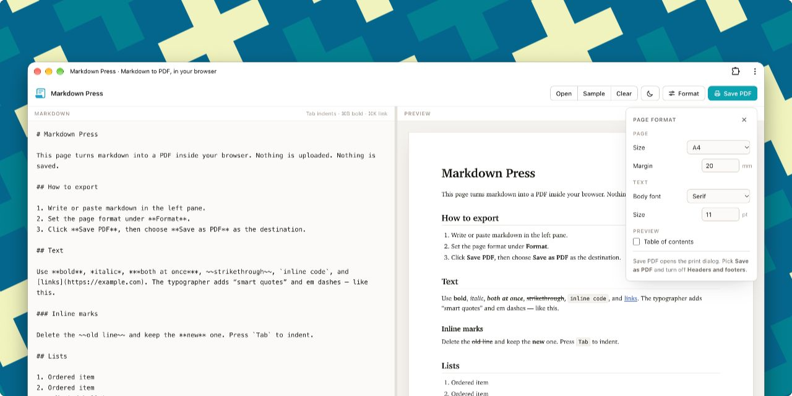

# Markdown Press

Markdown to PDF, in your browser.

Write or paste markdown, set the page, export. No upload. No account. No draft storage.



## Use it

1. Open the page.
2. Type or paste markdown in the left pane.
3. Click **Save PDF**, then choose **Save as PDF** as the destination.

The browser writes a real PDF. Text stays selectable and links stay clickable.

## Features

- Live preview with word count and page count. The print dialog shows the real page breaks.
- Page size, margin, body font, and text size controls.
- Optional table of contents.
- Code highlighting, tables, task lists, and footnotes.
- Drag a markdown file onto the page, or use a keyboard shortcut.
- Installable as a PWA. The install runs offline.
- One self-contained build file that opens from disk.

## Privacy

The draft stays in this tab. The app makes no background network request to a third party. It stores
one flag, which remembers that the info screen was shown. Nothing else is stored. A click on a
Markdown or Ko-fi link opens its destination. A refresh discards the draft. Read
[the privacy model](docs/privacy.md) for the details.

## Run it

You need Node 22.12 or newer.

```bash
make setup
make dev
```

`make` alone lists every task. Run `make build` to produce `dist/index.html`, one file that opens
from disk with no server.

## Docs

- [Architecture](docs/architecture.md): components, render pipeline, pagination, page geometry.
- [Printing](docs/printing.md): the PDF path, break rules, browser notes.
- [Privacy](docs/privacy.md): what is blocked, what is not covered, how to audit.
- [Development](docs/development.md): commands, tests, deployment.

## License

Licensed under the [Apache License 2.0](LICENSE).
